# KvClient 全操作流程图

> 源码仓库：`D:\xiaojun\work\DramPool\unified-cache-management`
> 分支：`z00984767-0917`
> 生成日期：2026-10-21
> 图中行号均来自当前分支代码，路径相对仓库根目录。
> 图使用 Mermaid 语法，VSCode Markdown 预览可直接渲染（建议安装 Mermaid 插件）。

---

## 目录

1. [图例：线程与三级任务模型](#1-图例线程与三级任务模型)
2. [Init 全流程](#2-init-全流程)
3. [后台视图刷新](#3-后台视图刷新)
4. [Shutdown 全流程](#4-shutdown-全流程)
5. [QueryAsync + Check/Wait](#5-queryasync--checkwait)
6. [DeleteAsync + Wait](#6-deleteasync--wait)
7. [StoreAsync / LoadAsync（单条 entry 路径）](#7-storeasync--loadasync单条-entry-路径)
8. [BatchStoreAsync / BatchLoadAsync](#8-batchstoreasync--batchloadasync)
9. [RegisterRegions / UnregisterRegions](#9-registerregions--unregisterregions)
10. [Check / Wait / 任务状态机](#10-check--wait--任务状态机)
11. [读图时最容易看错的 8 个点](#11-读图时最容易看错的-8-个点)
12. [附录：关键源码索引](#12-附录关键源码索引)

---

## 1. 图例：线程与三级任务模型

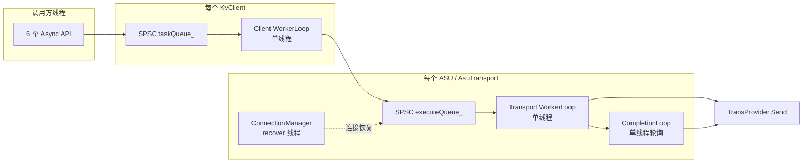

| 层级 | 对象 | 数量 | 完成判定 |
|---|---|---|---|
| L1 | `ClientTask` | 每次 API 调用 1 个 | `remainingTransportTasks` 归零 → `Finalize` |
| L2 | `TransportTask` | 每个被路由命中的 ASU 1 个 | `remainingSubBatchCount` 归零 |
| L3 | `TransportSubBatch` | 每个 SQE 1 个 | 收到匹配 cid 的 CQE |

**两条独立超时**

- `TransportConfig.timeoutMs`（默认 100ms）：管 TransportTask 的子批 deadline。
- `KvClientConfig.defaultWaitTimeoutMs`（默认 100ms）：管调用方 `Wait` 的阻塞时长。

**两类入口**

- **keys 路径**：`QueryAsync` / `DeleteAsync`。
- **entries 路径**：`LoadAsync` / `StoreAsync` / `BatchLoadAsync` / `BatchStoreAsync`。

**线程数量**

- 每个 `KvClient`：1 个 Client WorkerLoop。
- 每个 `AsuTransport`：1 个 WorkerLoop + 1 个 CompletionLoop + ConnectionManager 的 recover 线程。
- CQE 是**轮询**出来的，不是中断/回调推送。

---

## 2. Init 全流程

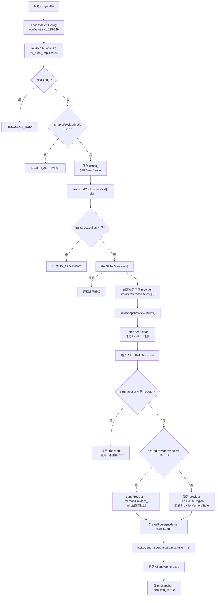

### 关键分支

- `BuildSnapshot` 失败时只回滚 `providerMemoryStates_` 和 `memoryProvider_`（`kv_client_impl.cc:170-175`）；`viewServer_` / `transportConfigs_` / `config_` 保留。
- `BuildTransport` 全程持有 `memoryMu_`，包括 `transport->Init`（建连）和 `BindMemory`（`kv_client_impl.cc:685-739`），因此注册内存与新增 ASU 完全串行。
- **视图可能为空**：配置文件型 ViewServer 读不到 `asuIds` 时 `asuMap` 为空，`Init` 仍返回 OK，直到第一次 Submit 才报 `NOT_INITIALIZED`。
- `CreateRouter` 返回值没有判空；返回 null 会延迟到 Submit 时才暴露。
- 队列有效容量 = `max(2, maxInflightTasks)`（SPSC 环形队列空一格）。
  - `Setup(queueDepth + 1)`，其中 `queueDepth = max(2, maxInflightTasks)`。
- `GetSnapshot()` 在 `mutex_` 下读，`initialized_` 是普通 bool，因此 Init 与并发调用之间依赖外部串行化。

### 初始化失败的分层清理

| 失败点 | 清理动作 |
|---|---|
| ViewServer 工厂返回 null | 无资源需清理 |
| transportConfigs 为空 | 已有 `viewServer_` / `config_` 不回收 |
| GetGlobalView 失败 | 尚未创建 provider |
| memory provider 创建失败 | 无 |
| BuildSnapshot 失败 | 清空 `providerMemoryStates_`、reset `memoryProvider_` |
| transport Init / Bind 失败 | 新建的 transport 随 snapshot 析构触发 Shutdown |

---

## 3. 后台视图刷新

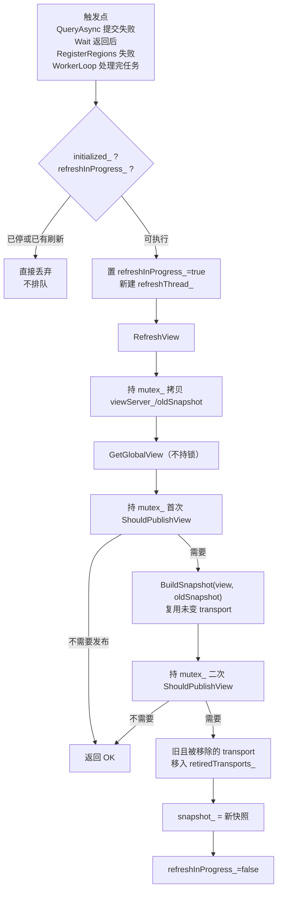

### 关键点

- **发布判据**：双方 `viewEpoch` 都非 0 时要求严格递增；任一方为 0 则每次都发布（`view_server.cc:122-127`）。
- 已存在的 nodeId 直接复用旧 transport，**不会重新执行服务端能力钳制**；只有新建 transport 才重新读取 `ServerKvCapabilities`。
- 被移除的 transport 只进 `retiredTransports_`，**直到 Shutdown 才真正关闭**。
- 刷新失败不会回滚 `BuildTransport` 已追加的 `ProviderMemoryState`。
- **刷新不排队**：`refreshInProgress_` 为 true 时，新的刷新请求直接丢弃。
- **触发白名单**：`CONNECTION_ERROR` / `IO_ERROR` / `TIMEOUT` / `NOT_FOUND` / `BUFFER_NOT_REGISTERED`（聚合状态或任一 entry 状态）。
- **入口不对称**：`QueryAsync` 提交失败与 `Wait` 返回会触发刷新；`LoadAsync` / `StoreAsync` / `BatchLoadAsync` / `BatchStoreAsync` / `DeleteAsync` 的提交失败**不会**触发。

---

## 4. Shutdown 全流程

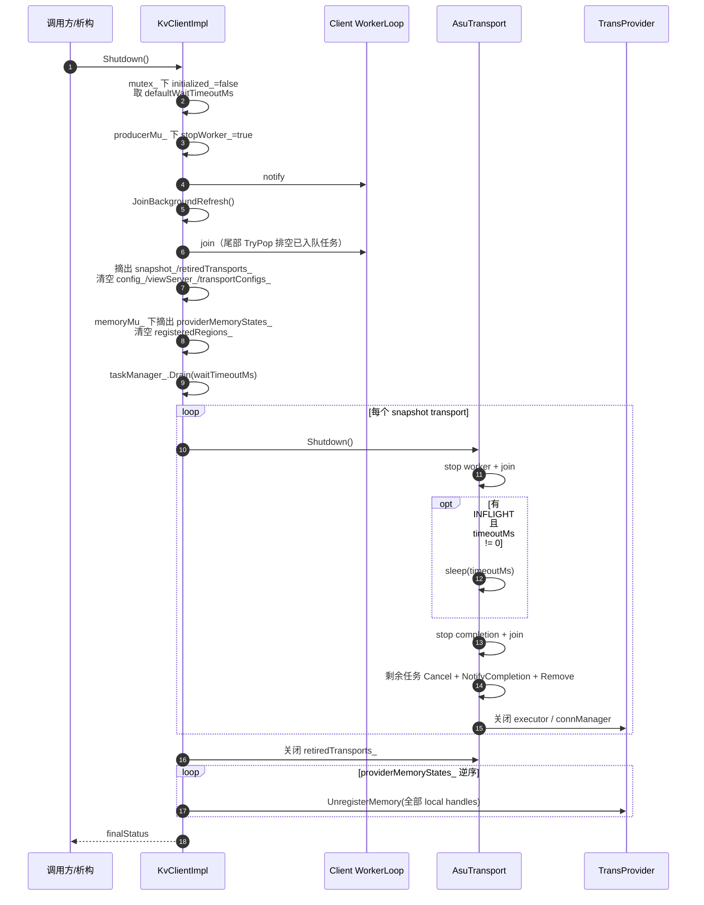

### 关键点

- `Drain` 的超时是**逐任务**计算，最坏总等待 ≈ 未完成任务数 × `defaultWaitTimeoutMs`，不是单个全局超时。
- `Drain` 超时后**仍继续**关闭 transport 和注销内存。
- transport `Shutdown` 若仍有 INFLIGHT 且 `timeoutMs != 0`，会先 sleep 一个 `timeoutMs`；多个 transport 的等待会叠加。
- 顺序是 `JoinBackgroundRefresh` → worker join，且 `initialized_` 已先置 false，worker 内部的刷新请求会被丢弃，不会留下未 join 的线程。
- **transport 关闭顺序不确定**：`snapshot->transports` 是 `unordered_map`，遍历顺序不保证。
- **provider 注销严格逆序**：`providerMemoryStates_` 的最后一个先注销，`memoryProvider_`（index 0）最后。
- `Shutdown` 绕过 `UnregisterRegions`，直接对每个 ProviderMemoryState 调用 `UnregisterProviderRegions`。

---

## 5. QueryAsync + Check/Wait

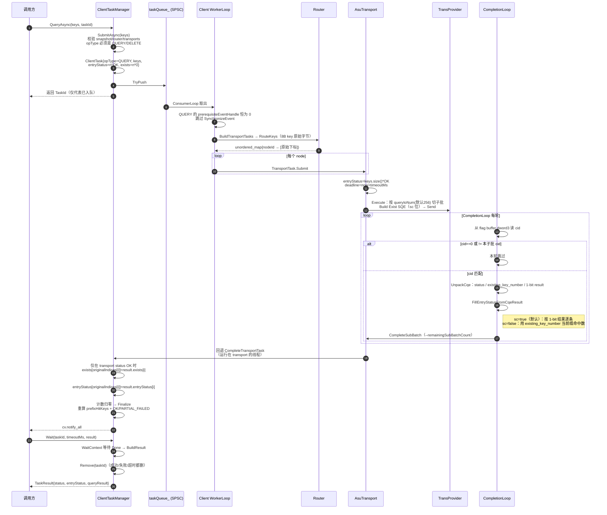

### Query 的 sc / useSeekControl 分支

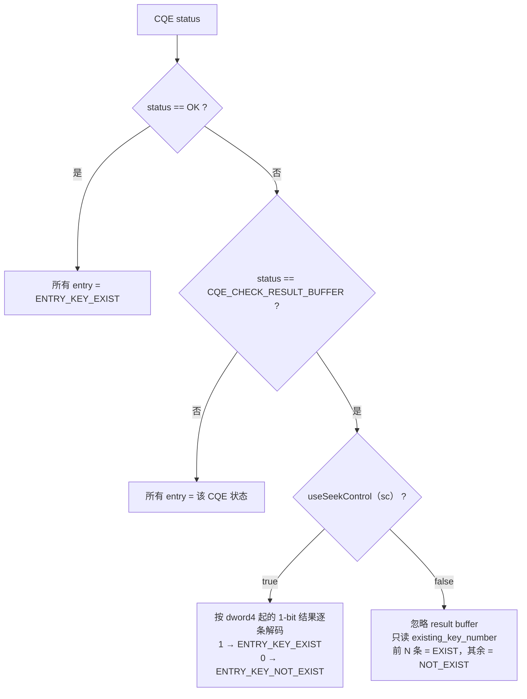

### 必须记住的语义

- `exists` 在提交时预分配为 `keys.size()` 个 0，最终按 `originalIndices` 回填，**顺序与调用方一致**。
- `prefixHitKeys` 在 transport 层算过一次，但客户端 `Finalize` **会基于合并后的 exists 重新计算并覆盖**（`task_manager.cc:232-238`）。
- Query 的“key 不存在”**不是任务失败**：`CQE_CHECK_RESULT_BUFFER` 被归一化为 OK，缺失 key 只体现在 `entryStatus` 和 `exists=0`。
- **陷阱**：如果某个 transport task 的最终状态非 OK（例如部分子批失败），客户端会**整个跳过 exists 合并**，该分片对应的 `exists` 保持初始 0，看起来像“全部未命中”。
- `Check` 对不存在的 TaskId 返回 `true`；`Wait` 对不存在的返回 `TASK_NOT_FOUND`。
- `Wait` 超时后任务仍被 `Remove`，后台继续跑但结果再也取不到。
- 默认 `sc=true`：走 per-key 1-bit 结果缓冲区；配置 `sc=false` 才走 `existing_key_number` 前缀语义。

---

## 6. DeleteAsync + Wait

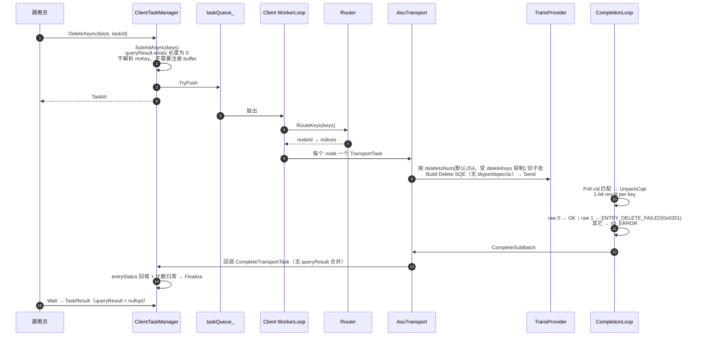

### 关键点

- Delete 走 keys 重载，**完全不触碰 `registeredRegions_` / mrKey**，调用方无需注册 buffer。
- Delete 的 entry 状态基址是 `0x0200`，与 Query（`0x0300`）、批读写（`0x0100`）不同。
- `CQE_CHECK_RESULT_BUFFER` 对 Delete **不归一化成 OK**，因此任一 key 失败会把整批拉成 `PARTIAL_FAILED`。
- Delete 的 SQE 没有 `dtype` / `dspec` / `sc` / `lr`；`rflag` 恒为 true，响应地址指向 flag buffer。
- **UCM 的 `AsuStore` 从不调用 Delete**（`StoreV1` 没有删除接口），这条路径主要给 kv-test 和单测用。
- 空 key 向量不会报错：路由结果为空 → 直接 `Finalize` 为 OK。

---

## 7. StoreAsync / LoadAsync（单条 entry 路径）

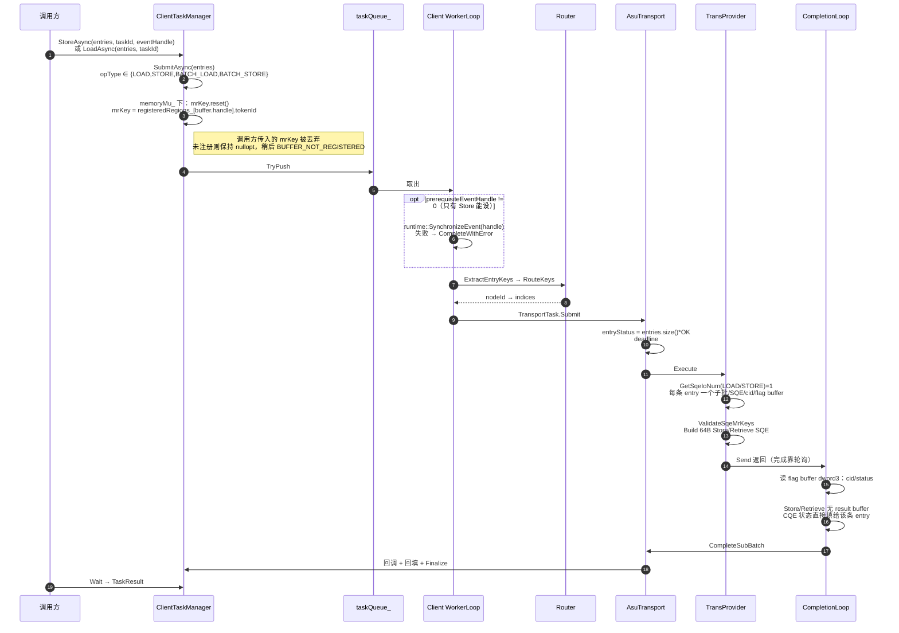

### 关键点

- `GetSqeIoNum` 对 `LOAD` / `STORE` **硬编码返回 1**（`io_scheduler.cc:82`）。所以传 N 条给 `StoreAsync` 会发出 **N 个 SQE、N 个 cid、N 个 flag buffer**；而 `BatchStoreAsync` 只发 `ceil(N/ioNum)` 个。
- 只有 `StoreAsync` / `BatchStoreAsync` 有 `eventHandle` 重载；`LoadAsync` / `BatchLoadAsync` 没有。event 在**唯一的 client worker 线程上同步等待**，会阻塞所有排队的 client 任务（队头阻塞）。
- 单条 SQE 不设置 `rflag` / 响应地址，但 transport 仍分配 17B flag buffer 并轮询 CQE 头。
- `KVBuffer` 没有 per-entry 长度字段：SQE 的 `length` 取 `buffer.region.size`，即整段注册区域的长度。
- Store 额外编码 `dtype`（3 bit）/ `dspec`（5 bit）；Retrieve 没有这两个字段。
- 两种 SQE 都是固定 16 dword = 64 字节。
- 传输长度上限 24 bit（`0xFFFFFF`），且 buffer 地址 / offset 必须 512B 对齐。

---

## 8. BatchStoreAsync / BatchLoadAsync

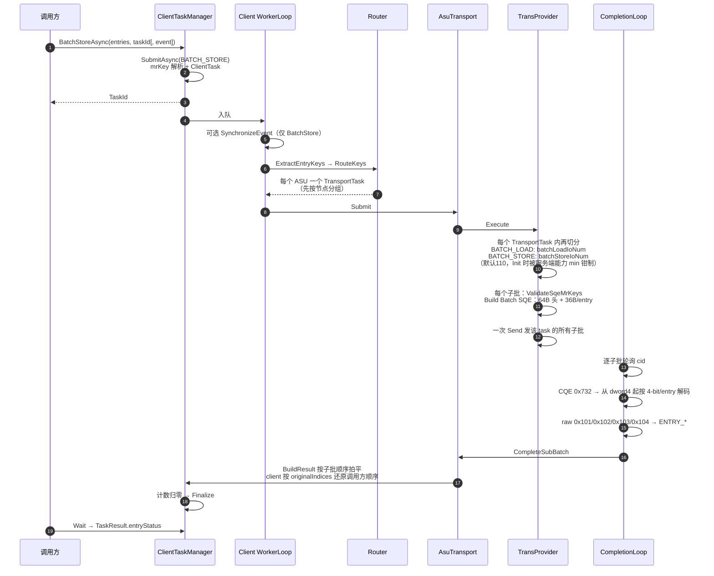

### 关键点

- **切分顺序**：先按 ASU 路由，再在每个 TransportTask 内按 ioNum 切。`batch_number` 是子批大小，不是调用方批大小。
- 服务端能力钳制：`min(config, advertised)`，能力值为 0 表示“未声明”、不钳制（`kv_transport_impl.cc:130-138`）。
- **协议硬上限 110**。配置超过 110 且无服务端钳制时，通常是 **flag buffer 容量（默认 71 = 16 + ceil(110/2)）先分配失败**，而不是 SQE 校验失败。
- 每子批的 flag buffer = `16 + ceil(N/2)` 字节；结果 4-bit/entry，entry 0 是第一个结果 dword 的低 4 位。
- 只要任一子批状态非 OK，**transport 任务就是 `PARTIAL_FAILED`，client 顶层也是 `PARTIAL_FAILED`**；具体哪条失败只能看 `entryStatus`。
- `BatchLoadAsync` 没有 `eventHandle` 重载。
- 单条 batch entry 的 36 字节布局：offset(4) + key(8) + reserved(8) + buffer_addr(8) + length/mr_key(4) + mr_key/DptrType(4)。
- `dtype` / `dspec` 只在 BatchStore 中编码；BatchRetrieve 的对应字段保持 0。

---

## 9. RegisterRegions / UnregisterRegions

### 9.1 RegisterRegions

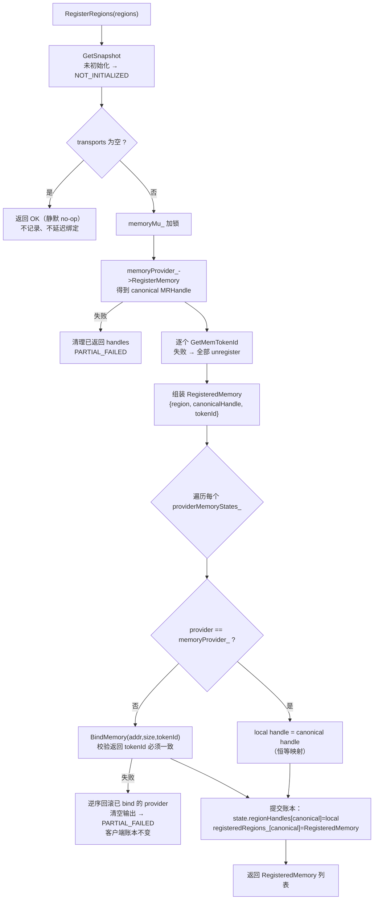

### 9.2 UnregisterRegions

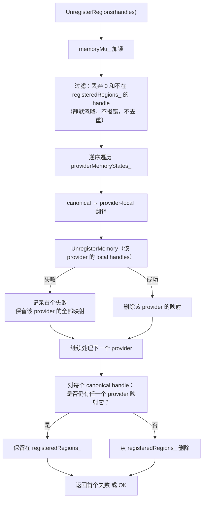

### 关键点

- **两层 handle 映射**：`registeredRegions_` 用 canonical handle；每个 `ProviderMemoryState.regionHandles` 维护该 provider 的 local handle。`memoryProvider_` 那一层是恒等映射。
- `SubmitAsync(entries)` 在 `memoryMu_` 下用 `registeredRegions_` 填 `mrKey = tokenId`；未注册不会立刻报错，直到 transport 的 `ValidateSqeMrKeys` 返回 `BUFFER_NOT_REGISTERED`。
- `UnregisterRegions` 的部分失败语义是**有意保留映射**：该 canonical handle 会继续留在 `registeredRegions_`，`mrKey` 仍能解析，但 provider 上可能已不存在。重试会重发整批。
- `Shutdown` **绕过** `UnregisterRegions`，直接逆序注销所有 provider state。
- 新建 ASU 时，`BuildTransport` 会把当前 `registeredRegions_` 全部 `BindMemory` 到新 provider；bind 后的 `tokenId` 必须与注册时一致。
- **`transports` 为空时静默返回 OK**：此时注册的 region 不会被记录，后续 ASU 出现时也不会补绑。
- `RegisterRegions` 不检测重复注册；同一次调用中重复的 canonical handle 由 `emplace` 首个生效。
- Header 契约：**被排队或在飞任务引用的 handle 必须保持注册**（`kv_client.h:58-59`）；代码没有对在飞任务做保护。

---

## 10. Check / Wait / 任务状态机

```mermaid
stateDiagram-v2
    [*] --> PENDING: TaskManagerBase::Submit<br/>分配 TaskId
    PENDING --> INFLIGHT: ClientTaskManager::Process<br/>或 TransportTaskExecutor::Execute
    INFLIGHT --> COMPLETED: Finalize<br/>或 CompleteWithError<br/>或 Cancel
    COMPLETED --> REMOVED: Wait / Drain → Remove
    REMOVED --> [*]

    note right of PENDING
        Check → false
        Wait → 阻塞
    end note
    note right of COMPLETED
        Check → true
        Wait → 立即返回结果并 Remove
    end note
    note right of REMOVED
        Check → true（无法区分“不存在”）
        Wait → TASK_NOT_FOUND
    end note
```

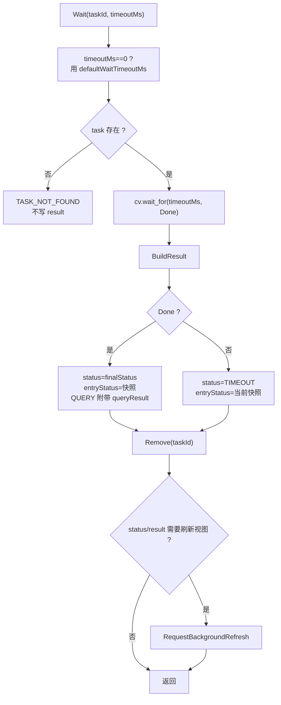

### 结果聚合规则

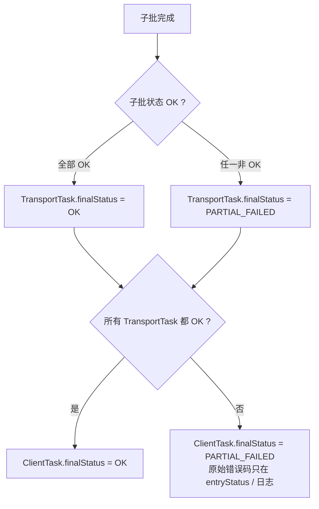

### 关键点

- `Wait` 是**破坏性读**：成功、失败、超时都会 `Remove`。
- `Wait` 返回的是 `WaitContext` 的状态，也就是 `TaskResult.status`；完成后的值可能是 `OK`、`PARTIAL_FAILED`、`TIMEOUT` 或客户端级错误码，**不一定是原始 CQE 错误码**。
- `Check` 对已移除 / 未知 TaskId 返回 `true`，无法区分“不存在”和“已完成”。
- 正常完成但调用方从不 `Wait` 的任务，会一直留在 `ClientTaskManager` 的 map 中，直到 `Shutdown::Drain`。
- `CompleteWithError` 路径会把**所有** `entryStatus` 覆盖为同一个错误码。
- 预发送失败时：`AbortSubBatchesBeforeSend` 先把 task 级 `entryStatus` 全填 `CANCELED`，再由各子批的 `entryStatus` 覆盖；**失败之前已构建但从未发送的子批会保留 OK**。
- transport 侧 `finalStatus` 不只 OK / PARTIAL_FAILED：deadline 到期是 `TIMEOUT`，`Cancel` 是 `CANCELED`。

---

## 11. 读图时最容易看错的 8 个点

1. **顶层状态几乎总是 `PARTIAL_FAILED`**
   任何 transport task 失败都聚合为它，真实错误码只在 `entryStatus` 和日志里。100% 失败也不会是 `IO_ERROR` / `TIMEOUT`。

2. **Query 的 `exists` 在失败的 transport 分片上不合并**
   客户端只在 `completionStatus.ok()` 时写回 exists；失败分片保持初始 0，看起来像“未命中”。

3. **`AbortSubBatchesBeforeSend` 的语义**
   先把 task 级 `entryStatus` 全填 `CANCELED`，再由各子批的 `entryStatus` 覆盖；失败之前的子批从未发送，却保留 OK。

4. **单条 vs 批量的 SQE 数量**
   `ioNum=1` 让 `StoreAsync(N)` 变成 N 个 SQE；`BatchStoreAsync(N)` 是 `ceil(N/110)` 个。

5. **能力钳制只发生一次**
   复用旧 transport 不会重新读取服务端能力；只有新建 transport 才重新 clamp。

6. **`LoadAsync` 不能带 event，`StoreAsync` 可以**
   event 在唯一的 client worker 上阻塞等待，会造成队头阻塞。

7. **`Wait` 只此一次；`Check` 对未知 id 返回 true**
   `Wait` 超时也会移除任务，后台继续执行但结果不可再取；transport 的 `onComplete` 只持有 `weak_ptr`，late completion 会被静默丢弃。

8. **`retiredTransports_` 只在 Shutdown 清理**
   视图频繁变化的长期进程会累积旧 transport 的连接 / 线程 / 缓冲。

### 额外提醒

- 空输入或所有 key 路由失败时，任务会**直接 `Finalize` 为 OK**，完全不碰 transport。这些 entry 的 `entryStatus` 保持初始 OK，Query 的 `exists` 保持 0。
- `TaskId` 在 client 层和 transport 层各自独立编号，同一个数值没有关系。
- `KvClient` 没有取消 API；transport 层有 `Cancel(TaskId)`，但注释明确是 best-effort，不中断底层 UB/RoCE IO。
- `TransportTaskManager::BuildResult` 按子批顺序拍平，**不是调用方顺序**；调用方顺序由 `originalIndices` 在 client 层还原。
- `prefixHitKeys` 会计算两次，客户端 `Finalize` 的结果覆盖 transport 层的值。

---

## 12. 附录：关键源码索引

| 模块 | 文件 | 关键内容 |
|---|---|---|
| 公共接口 | `kv_semantics/include/kv_client.h` | 6 个数据 API、Check/Wait、内存注册 |
| 公共类型 | `kv_semantics/include/kv_types.h` | StatusCode、KVBuffer、MemoryRegion、KvClientConfig |
| 门面实现 | `kv_semantics/src/client/kv_client_impl.cc` | Init/Shutdown/Submit/内存注册/视图刷新 |
| 任务上下文 | `kv_semantics/src/common/utils/task_context.h` | ClientTask / TransportTask / SubBatch |
| 任务管理基类 | `kv_semantics/src/common/utils/task_manager_base.h` | TaskId 分配、map 管理 |
| Client 任务聚合 | `kv_semantics/src/client/task/task_manager.cc` | 路由拆分、完成回填、Finalize、Wait |
| 路由 | `kv_semantics/src/client/router/router.cc` | RingHash / Maglev / 连续块 / BatchTopK |
| 视图 | `kv_semantics/src/client/view/view_server.cc` | GetGlobalView、发布判据、刷新判据 |
| Transport 门面 | `kv_semantics/src/trans/kv_transport_impl.cc` | Init/Submit/两个 Loop/Shutdown |
| Transport 执行 | `kv_semantics/src/trans/task/trans_task_executor.cc` | Execute / Poll / Cancel |
| 子批构建 | `kv_semantics/src/trans/task/kv_submit_flow.cc` | 拆分子批、构建请求、Send |
| 切分粒度 | `kv_semantics/src/trans/task/io_scheduler.cc` | GetSqeIoNum、SplitForAsu |
| 请求构造 | `kv_semantics/src/trans/proto/sqe_request.cc` | Store/Retrieve/Batch/Delete/Exist/KeepAlive |
| 协议编解码 | `kv_semantics/src/trans/proto/kv_protocol.cc` | SQE 打包、CQE 解包、result buffer |
| 状态映射 | `kv_semantics/src/trans/utils/trans_task_utils.cc` | CQE / entry 状态映射 |
| Transport 结果 | `kv_semantics/src/trans/task/trans_task_manager.cc` | 子批聚合、BuildResult |
| 内存缓冲 | `kv_semantics/src/trans/buffer/buffer_manager.h` | slot 分配、双地址（local/device） |
| 连接管理 | `kv_semantics/src/trans/conn/connection_manager.h` | 连接选择、健康度、恢复 |
| Provider 接口 | `kv_semantics/src/trans_provider/trans_provider.h` | Register/Bind/Unregister/Send |
| 配置解析 | `kv_semantics/src/client/utils/config_utils.cc` | KvClientConfig 文件解析 |
| 单测 | `kv_semantics/tests/client/kv_client_impl_test.cc` | 路由、部分失败、内存注册 |
| 用法样例 | `kv_semantics/kv_test/src/kv_client_runner.cc` | 单条 / 批量调用模式 |
| UCM 消费方 | `ucm/store/asu/cc/asu_store.cc` | Lookup / Load / Dump 到 KvClient 的映射 |

### 完整调用链（一句话版）

```
KvClient API
  → ClientTaskManager（TaskId + map）
  → taskQueue_（SPSC）
  → Client WorkerLoop（路由 + 拆分 TransportTask）
  → AsuTransport::Submit
  → executeQueue_（SPSC）
  → Transport WorkerLoop（切子批 + 建 SQE + provider->Send）
  → CompletionLoop（轮询 flag buffer + 解 CQE）
  → TransportTaskManager::NotifyCompletion
  → ClientTaskManager::CompleteTransportTask（originalIndices 回填）
  → Finalize（OK / PARTIAL_FAILED）
  → Wait → TaskResult
```
